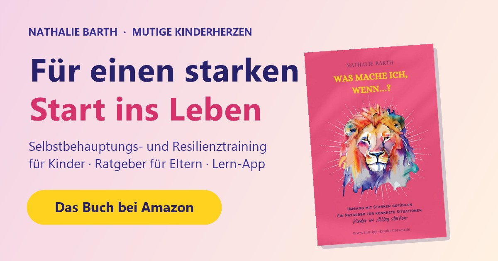

**🦁 Live ansehen: [https://www.mutige-kinderherzen.de/](https://www.mutige-kinderherzen.de/)**

# NATBARTH: Webseite und App für Nathalie Barth

Moderne, motivierende Webseite für Nathalie Barth (Selbstbehauptungs- und Resilienztraining für Kinder, „Mutige Kinderherzen“) mit Kursen und Terminen direkt unter dem Einstieg, starkem Fokus auf den Ratgeber **„Was mache ich, wenn…?“** und der Lern-App **WAS MACHE ICH WENN APP**. Alles ist statisch (HTML, CSS, JS), läuft ohne Server-Code und ist als PWA installierbar. Stand: Version 1.0.20, 15.10.2026.

> **Veröffentlichung:** Die Seite ersetzt die alte Webseite unter `https://www.mutige-kinderherzen.de/` (Hosting bei IONOS, Frankfurt; per DNS, IP-Zuordnung, MX und SPF geprüft). Die absoluten Adressen für Link-Vorschau (`og:image`, `canonical`, JSON-LD) in `index.html` und `was-mache-ich-wenn-app/app.html` zeigen auf diese Domain. Die GitHub-Pages-Adresse (`nosz.github.io/natbarth`) dient nur zum Testen; dort stimmen die Vorschau-Bilder in Messengern nicht, weil sie auf die Produktiv-Domain verweisen. Alle anderen Verweise sind relativ. Dateinamen der alten Seite (`index.html`, `impressum.html`) bleiben gleich, die alten Anker (`#article04-1a` Kurse, `#list01-3` Fragen, `#form02-s` Anfrage) führen weiter an die passenden Stellen.

## Inhalt

| Datei / Ordner | Zweck |
|---|---|
| `index.html` | Startseite: Hero, **Kurse und Termine**, Mission, Buch, Angebote, App-Teaser, Über mich, FAQ, WhatsApp-Kanal, Kontakt |
| `impressum.html`, `datenschutz.html` | Rechtstexte, übernommen aus `quellen/impressum_text.txt` (Wortlaut unverändert, nur Layout und Silbentrennungs-Artefakte korrigiert) |
| `stil.css`, `seite.js` | gemeinsames Design (hell und dunkel) und Skript (Menü, Mailtexte, PWA) |
| `manifest.webmanifest`, `sw.js`, `icon-*.png`, `favicon.png`, `apple-touch-icon.png` | PWA der Webseite (Icons liegen bewusst im Hauptordner) |
| `vorschau_natbarth.jpg` | Link-Vorschau 1200 × 630 |
| `bilder/` | aufbereitete Fotos, Cover, Logo (aus `quellen/`) |
| `was-mache-ich-wenn-app/` | eigene PWA: `app.html`, `index.html` (leitet auf `app.html` weiter), Manifest, Service Worker, Icons, `vorschau_app.jpg` |
| `quellen/` | Ausgangsmaterial (unverändert) |

Die App ist erreichbar unter `…/was-mache-ich-wenn-app/app.html` (und `…/was-mache-ich-wenn-app/`). **Alle Dateien samt Unterordnern und Icons in die Wurzel des Webspace hochladen** (ohne `quellen/`, falls nicht gewünscht).

## Gestaltung und Ton

* **Farben** aus `quellen/farben_logo.png` und dem Cover gemessen: Indigo `#393193` (Schrift und Logo), Pink `#e5547b` (Cover, Pullover), Gold `#ffd21f` (Buchtitel), Hintergrund `#edefeb`. Für Text auf Pink kommt ein dunkleres `#c2255c`, damit der Kontrast stimmt.
* **Ton** aus `quellen/buch_info.docx` und der alten Webseite: Du-Ansprache, Ich-Form für Nathalie, warm, direkt, ermutigend („Alle Gefühle sind erlaubt, nur nicht jede Handlung“, „Du kannst es NOCH nicht“). Die App ist neutral und seriös formuliert.
* Keine externen Schriften, keine Tracker, keine Cookies. Persönliche Angaben aus dem Buch (Familiengeschichte) werden bewusst nicht verwendet.
* Bilder: Gesichter von Kindern sind in den Originalen bereits verdeckt und bleiben es.

## Kurse und Termine

Direkt unter dem Hero (Abschnitt `#kurse`), Quelle: `quellen/info_webseite_quelltext.txt` (Quelltext der alten Seite):

* **Offener Wochenendkurs** für Kinder von 6 bis 11 Jahren: Sa. 24.10. und So. 25.10.2026, jeweils 11 bis 13 Uhr, € 69,– inklusive Elterninfo, ab 4 teilnehmenden Kindern, FSV Harburg, Vinzenzweg 20, 21077 Hamburg.
* **Fortlaufender Kurs**, jederzeit einsteigen: montags 16 bis 17 Uhr, € 49,– pro Monat ab September 2026, kleine Gruppe, aktuell noch 3 freie Plätze.
* **Kitas** (5 bis 7 Jahre, max. 12 Kinder, z. B. 4 × 60 Minuten) und **Grundschulen** (Klasse 1 bis 4, z. B. 3 × 90 Minuten in einer Klasse).
* „So meldest du dein Kind an“ in 3 Schritten, sechs Fragen zur Anmeldung, „Das lernen Kinder“, „Für Eltern“, „Für Schulen und Kitas“, Konzept „Stark auch ohne Muckis“, Aus- und Weiterbildungen, Kontaktdaten und Instagram.
* **Anfrage-Dialog:** Jeder Kurs und jedes Angebot hat einen Button, der ein Fenster öffnet: Der Besucher trägt Angaben ein, die Nachricht (mit Datum und Ort, Bitte um Teilnahmebedingungen und Zahlungsmodalitäten) baut sich live auf und lässt sich anpassen. Gesendet wird per E-Mail-Programm, WhatsApp (0160 3148838), Gmail, Outlook (Web), kopiert oder per Anruf. Es werden keine Daten an Dritte übermittelt; ohne Dialog-Unterstützung des Browsers bleibt der normale E-Mail-Link. Adresse, Anrede, WhatsApp-Nummer und Texte stehen oben in `seite.js` (`MAIL`, `ANREDE`, `WHATSAPP`, `ANGEBOTE`). Die einzige E-Mail-Adresse auf der Seite (Kontakt, Anfragen, Impressum, Datenschutz) ist `nathalie.barth@mutige-kinderherzen.de`.
* Ist der Termin des Wochenendkurses vorbei (`data-kurs-datum` und `data-kurs-ende` in `index.html`), wechselt die Karte automatisch auf „Termin ist vorbei“ und „Nächsten Termin anfragen“. Auf dem Handy führt eine feste Leiste zu „Kurse und Termine“.
* **Pflege:** Termine, Preise und freie Plätze stehen direkt im HTML (`#kurse`). Nach jeder Änderung die Version in `sw.js` erhöhen, damit Besucher den Update-Hinweis bekommen.
* **Elternstimmen** („Das sagen Eltern“, 3 Rückmeldungen mit Vorname und Initial wie auf der alten Webseite) und der persönliche Abschluss „Ich freue mich, dich und dein Kind kennenzulernen“ mit Anfrage-Button. An den Zitaten geändert: Tippfehler und Leerzeichen korrigiert („Selbsbewusstsein“, „Nathalie's“), „Löwen/innen“ zu „Löwen und Löwinnen“, und der Vorname des Kindes („Mila“) entfernt (Datenschutz für das Kind), dafür „Sie“.
* Bewusst nicht übernommen: unbelegte Statistik zu Mobbing („Die Fakten“) und die „7 Tipps“.

## Buch bestellen

Amazon-Link in der Navigation, im Hero, in der Buch-Sektion, als feste Leiste am unteren Rand auf dem Handy und im Abschluss-Block. Dazu: konkrete Nutzenversprechen, Sätze aus dem Buch und FAQ. Es gibt keine erfundenen Bewertungen, Preise oder Verknappungs-Tricks.

## WAS MACHE ICH WENN APP

Lern-App nach dem Buch, seriös gestaltet: 7 Module (Gefühle, Wut und Traurigkeit, Schüchtern/Angst/Scham, Streit, Alltag, Schule und Veränderungen, Abschlussrunde), je mit Karten, Merksatz, Vertiefung, Kapitelverweis und 4 bis 6 Quizfragen. Dazu Merksatz des Tages, Sterne und Stand, Namens-Personalisierung (nachträglich änderbar), Teilnahmebestätigung pro Modul und Zertifikat nach allen sieben Modulen (PNG-Download und Druck), Hinweis „Hilfe finden“ mit Anlaufstellen, Offline-Betrieb, Update-Hinweis. Der Fortschritt bleibt nur im Browser des Geräts (`localStorage`).

## Tests (15.10.2026, Version 1.0.20)

* UX-Suite U1 bis U10 (320, 360, 390 px, Querformat) für Startseite, Impressum, Datenschutz und App, jeweils hell und dunkel: alle bestanden.
* App-Ansichten (Überlauf, Schriftgröße, Kontrast, Tippziele, Ränder) für Start, Modul, Quiz, Ergebnis, Bestätigungen und Namensabfrage, hell und dunkel; alle 7 Module durchgespielt (Sterne, Persistenz, schlechtere Folgerunde ändert den besten Stand nicht), 40 Urkundenvarianten mit langen Namen und Sonderzeichen.
* Anfrage-Dialog: alle 8 Anfrage-Buttons, Live-Nachricht, Links für E-Mail-Programm, WhatsApp, Gmail, Outlook (Web) und Anruf, Kopieren (mit echtem Klick geprüft), Schließen per Button und Hintergrund, Fokus zurück; Layout bei 320, 375, 420 und 800 px, hell und dunkel.
* 73 interne Verweise per HTTP, alle Anker und Bilder vorhanden; alle Amazon-, WhatsApp-, Instagram- und Mail-Links geprüft; 7 Anfrage-Mails mit vollständigem Text; kein Link öffnet einen neuen Tab.
* Externe Ziele (HTTP 200): Amazon-Buchseite, WhatsApp-Kanal, Instagram, EU-Streitschlichtung, e-recht24, IONOS.
* PWA: beide Service Worker, Caches, Manifeste, Icons; Webseite und App laden mit gestopptem Server offline, Name und Fortschritt bleiben erhalten.

## Offene Punkte vor der Veröffentlichung

1. **Termine und freie Plätze** („noch 3 freie Plätze“, Termin 24./25.10.2026) stammen aus dem Quelltext vom 15.10.2026. Bitte vor dem Upload mit Nathalie abgleichen.
2. **E-Mail-Adresse:** Auf Wunsch steht überall `nathalie.barth@mutige-kinderherzen.de`, auch im Impressum und in der Datenschutzerklärung (vorher dort die GMX-Adresse). Die Rechtstexte wurden dafür an dieser Stelle gegenüber der alten Seite geändert; bitte mit dem Rest der Rechtsprüfung (Punkt 3) abstimmen und sicherstellen, dass das Postfach erreichbar ist.
3. **Rechtstexte:** Impressum und Datenschutz stammen von der alten Webseite (IONOS, Analyse, Newsletter). Die neue Seite nutzt weder Analyse noch Newsletter; ob der Text und „§ 5 TMG“ (inzwischen DDG) aktuell passen, sollte die Geschäftsführung bzw. Rechtsberatung prüfen.
4. **Hilfe-Nummern** in der App (112, Elterntelefon 0800 111 0 550, Kinder- und Jugendtelefon 116 111, TelefonSeelsorge 0800 111 0 111 und 0800 111 0 222) bitte kurz gegen die Webseiten der Anbieter prüfen.
5. **Elternstimmen:** Bitte bestätigen, dass Jennifer D., Jeni W. und Yvonne J. der Veröffentlichung auch auf der neuen Seite zugestimmt haben bzw. zustimmen, und dass die kleinen Korrekturen an den Zitaten (siehe oben) in Ordnung sind.
6. Inhalte der App sind aus dem Buch abgeleitet. Nathalie sollte sie gegenlesen und freigeben.

## Änderungsprotokoll

- 1.0.20 (15.10.2026): Texte im Anfrage-Dialog und bei den Elternstimmen auf Ich-Form angeglichen; README bereinigt.
- 1.0.19 (15.10.2026): Produktiv-Adresse `https://www.mutige-kinderherzen.de/` in allen Vorschau-Tags; alte Ankernamen der bisherigen Seite bleiben gültig.
- 1.0.17 und 1.0.18 (15.10.2026): Anfrage-Dialog: Angaben eintragen, Nachricht live sehen, senden per E-Mail-Programm, WhatsApp (0160 3148838), Gmail, Outlook (Web), Text kopieren oder anrufen; ohne Datenübermittlung an Dritte.
- 1.0.16 (15.10.2026): „Das sagen Eltern“ (3 Rückmeldungen), persönlicher Abschluss mit Anfrage-Button, „Über mich“ mit Nathalies Worten (Vision, „Heldenkraft“) statt der Buchtexte.
- 1.0.15 (15.10.2026): E-Mail-Adresse überall `nathalie.barth@mutige-kinderherzen.de` (auch Impressum und Datenschutz).
- 1.0.14 (15.10.2026): Hero: Erklärtext in den gelben Amazon-Button integriert; „App ausprobieren“ mit Hinweis „Die App zum Buch“.
- 1.0.13 (15.10.2026): Texte auf durchgängige Ich-Form gebracht, „Hilfegeber“ zu „Ratgeber“ (wie auf dem Cover).
- 1.0.12 (15.10.2026): Hinweis-Buttons „Noch 9 Tage bis zum Kurs“ und „Noch 3 freie Plätze“ entfernt; grauen Streifen hinter den Kurs-Etiketten behoben.
- 1.0.11 (15.10.2026): Abstände zwischen den Abschnitten verringert.
- 1.0.10 (15.10.2026): Hinweiszeile unter den Kurs-Fragen entfernt.
- 1.0.9 (15.10.2026): Zittern beim Darüberfahren über die Kurs-Karten behoben (Klickbereich der Buttons).
- 1.0.6 bis 1.0.8 (15.10.2026): Kurse mit Terminen aus der alten Webseite direkt unter dem Hero (statt des Drei-Karten-Blocks), Anmelde-Schritten und FAQ; Satz-Karten aus dem Buch neu gestaltet; Instagram, Ausbildungen und Kontakt ergänzt; Mailtexte je Kurs; Termin-Teaser im Hero wieder entfernt.
- 1.0.5 (15.10.2026): Abschnitt „WhatsApp-Kanal“ mit Beitritts-Aufruf (auch im Footer).
- 1.0.2 bis 1.0.4 (15.10.2026): Themenfinder „Wobei brauchst du gerade Hilfe?“, Kursinfos-Button und Link zur alten Webseite entfernt.
- 1.0.1 (14.10.2026): Kursanfragen per vorformulierter E-Mail.
- 1.0.0 (14.10.2026): Erstfassung (Webseite, Impressum, Datenschutz, PWA, WAS MACHE ICH WENN APP).
